<div align="center">

<picture>
  <source media="(prefers-color-scheme: dark)" srcset="docs/assets/hero-dark.svg">
  
</picture>

<picture>
  <source media="(prefers-color-scheme: dark)" srcset="docs/assets/badges-dark.svg">
  
</picture>

</div>

**ipadmode** is a small macOS tool with one job. When I control my Mac mini from an iPad over RustDesk, it swaps the two monitors on the desk for a single virtual display shaped exactly like the iPad. Click **iPad Remote** in the Dock and the Mac becomes an iPad-sized Mac. Click **Layar Normal** ("normal display"), or press ⌃⌥⌘N, and both monitors come back where they were.

Switching displays is the easy part. Most of the code is about making sure the Mac never ends up without a working screen, whatever happens: the daemon crashes or hangs, the Mac locks, the RustDesk session drops, the power goes out, or a macOS update removes a private API.

<picture>
  <source media="(prefers-color-scheme: dark)" srcset="docs/assets/measured-dark.svg">
  
</picture>

## Why

Remoting into a Mac that drives a 3440×1440 ultrawide and a portrait 1080p monitor from an 11-inch iPad is miserable. The picture is letterboxed and tiny, and text is unreadable. Changing the resolution of the real monitors leaves the desk in a mess for when you're back.

ipadmode adds a HiDPI virtual display at the iPad's own aspect ratio (1180×820 points, 2360×1640 pixels), makes it the main display so RustDesk follows it, and turns the physical monitors off for the session only. When you're done, everything is put back.

## Features

<picture>
  <source media="(prefers-color-scheme: dark)" srcset="docs/assets/features-dark.svg">
  
</picture>

## How a switch works

<picture>
  <source media="(prefers-color-scheme: dark)" srcset="docs/assets/flow-dark.svg">
  
</picture>

Entering Remote mode is refused, with a message, when the Mac is locked, a switch is already running, the display APIs are missing, or the tool is in safe mode. Nothing changes in that case.

The way back always turns the monitors on and waits for them before the virtual display goes away. That order is the point of the whole design: there is no moment where the Mac has zero active displays.

## Architecture

<picture>
  <source media="(prefers-color-scheme: dark)" srcset="docs/assets/architecture-dark.svg">
  
</picture>

| Component | Role |
|---|---|
| `ipadmode daemon` | The only process that changes the display configuration in normal operation. Runs the coordinator state machine, the panels, the hotkey, lock detection, the command socket and a 1 s heartbeat. LaunchAgent `local.ipadmode.daemon`. |
| `ipadmode vdisplay` | Child of the daemon that owns the virtual display. The display disappears when this process exits, so if the daemon dies it turns the monitors back on first. Last one out turns the lights on. |
| `ipadmode watchdog` | A separate LaunchAgent. Every 0.5 s it checks the daemon. If the heartbeat is 5 s old while the monitors are off, it turns them on and stops the hung daemon. |
| CLI | Talks to the daemon over a `0600` Unix socket, one JSON line per request. `status --offline` reads the state files directly, so it works even when the daemon doesn't. |
| Dock applets | **iPad Remote** and **Layar Normal**, two AppleScript applets that call the CLI by absolute path. |

The Swift package is split so the logic can be tested without touching a display:

- `IPadModeCore` is pure logic in Swift 6 strict concurrency: state machine, restore planner, watchdog policy, IPC router, config and parsers.
- `IPadModeSystem` is the AppKit, CoreGraphics, Carbon and POSIX glue.
- `CPrivateDisplay` is an Objective-C shim around the private display APIs. Everything in it is resolved at runtime (`NSClassFromString`, `dlsym`) with no static references, so a macOS update that removes a symbol can't stop the binary from launching. The mode is refused and the Mac stays normal.

## Safety

<picture>
  <source media="(prefers-color-scheme: dark)" srcset="docs/assets/safety-dark.svg">
  
</picture>

## Command line

<picture>
  <source media="(prefers-color-scheme: dark)" srcset="docs/assets/terminal-dark.svg">
  
</picture>

```text
ipadmode remote [--confirm-seconds N]   enter Remote mode (N = 0..600, 0 skips the confirmation)
ipadmode normal                         back to the monitors
ipadmode status [--json] [--offline]    mode, displays and processes; --offline needs no daemon
ipadmode resolution WxH                 1180x820, 1321x918, 1416x984, 1534x1066 or 1652x1148
ipadmode doctor                         health check; exit code 2 if anything critical fails
ipadmode logs                           last 50 lines of the daemon and watchdog logs
ipadmode disable | enable               stop everything and restore Normal (safe over SSH), and back
```

Exit codes: `0` ok, `1` refused by the daemon, `2` failed, `3` daemon not running, `4` unsupported, `5` daemon busy, `6` invalid reply, `64` usage.

The UI text (panels, notices and CLI output) is in Indonesian.

## Install

Requirements:

- An Apple Silicon Mac. Developed and tested on a Mac mini M4 with macOS 27.0.1. The package targets macOS 14, but older systems are untested.
- Command Line Tools with Swift 6. Xcode is not needed.
- RustDesk 1.5 or later. Use the arm64 build: the Intel build under Rosetta has no hardware encoder.

```bash
git clone https://github.com/Lywannn/full-mac-remot-from-ipad.git
```

```bash
cd full-mac-remot-from-ipad && scripts/install.sh --dock
```

`install.sh` builds a release binary, assembles `iPadMode.app` and the two applets in `~/Applications/iPadMode/`, loads the LaunchAgents and, with `--dock`, adds the buttons to the Dock. `--dry-run` prints what it would do. If an older copy is installed, it refuses to run unless that copy is in Normal mode.

Then check the result:

```bash
~/Applications/iPadMode/iPadMode.app/Contents/MacOS/ipadmode doctor
```

Optionally, put the CLI on your `PATH`:

```bash
sudo ln -sf "$HOME/Applications/iPadMode/iPadMode.app/Contents/MacOS/ipadmode" /usr/local/bin/ipadmode
```

To remove it, run `scripts/uninstall.sh` (`--purge` also deletes state and logs). It disables the tool first, so the monitors are back before anything is removed.

### Configuration

`~/Library/Application Support/ipadmode/config.json`. Every key is optional.

```json
{
  "remote": { "resolution": "1180x820", "confirmSeconds": 20 },
  "hotkey": "ctrl+opt+cmd+n",
  "watchdog": { "intervalMs": 500, "heartbeatStaleSeconds": 5 }
}
```

Invalid values fall back to the defaults, and `doctor` reports a warning.

## Development

```bash
scripts/sw build
```

```bash
scripts/sw test
```

`scripts/sw` wraps SwiftPM. Build products go to `~/Library/Caches/ipadmode-build`, because the repo can live on an exFAT drive where SwiftPM is unreliable, and it retries the known TestingMacros plugin flake under Command Line Tools. Pass a filter as usual, e.g. `scripts/sw test --filter ConfigTests`.

- Unit tests use fakes for the display backend, the virtual display host, the clock and storage. The fakes reproduce what CoreGraphics actually does on hardware: late notifications, monitors that take seconds to wake, refused enables.
- Lifecycle tests run the real binary in dry-run mode (`IPADMODE_VDISPLAY_DRY_RUN=1`) without creating a display.
- Tests that change real displays are gated behind `IPADMODE_HW_TESTS=1` and `IPADMODE_DISPLAY_TESTS=1`. Only run them at the Mac, with a way to get the monitors back.

### Things the hardware taught me

Field notes from the spikes and the acceptance run are in [`docs/research/`](docs/research) (in Indonesian). The findings that shaped the design:

- On macOS 27, a `.forAppOnly` display configuration does **not** revert when the process dies, whatever the documentation says. Everything uses session scope, and crash recovery is the job of the watchdog and the child process.
- A process that has made its own display-configuration transaction stops seeing changes made by other processes unless it runs an AppKit event loop. All three processes run `NSApplication`, not a bare run loop.
- Monitors waking from standby can flap between online and offline and briefly vanish from the display list. The child waits until every monitor it has seen is back.
- CoreGraphics reports changes 0.05 to 0.31 s late, so every check after a transaction polls for a moment instead of reading once.
- macOS remembers a resolution per display identity and reapplies it later, so the configured resolution is applied again right before the monitors go off.

## Project layout

```text
Sources/
  CPrivateDisplay/   Objective-C shim for the private display APIs
  IPadModeCore/      state machine, planners, policies, IPC and config (pure Swift)
  IPadModeSystem/    CoreGraphics backend, panels, hotkey, socket, daemon and watchdog
  ipadmode/          CLI entry point
Tests/               Swift Testing suites for Core and System
applets/             the two Dock buttons (AppleScript)
launchd/             LaunchAgent property lists
scripts/             build, install, uninstall, the SwiftPM wrapper, icons
spikes/              ipadmode-spike, the hardware probe used during research
docs/research/       spike results and acceptance notes
```

## Roadmap

- [x] Remote mode: virtual display and RustDesk, in daily use
- [ ] Sidecar mode. `ipadmode sidecar` is reserved; research is in [`docs/research/2026-11-23/sidecar`](docs/research/2026-11-23/sidecar)
- [ ] Headless fallback display for when no monitor is connected

## A note on private APIs

ipadmode depends on undocumented macOS APIs (`CGVirtualDisplay`, `SLSConfigureDisplayEnabled` and a few others). They can change with any update. The tool is built to fail safe when that happens, but keep it on a machine you can reach physically, at least until you've watched it recover once.
